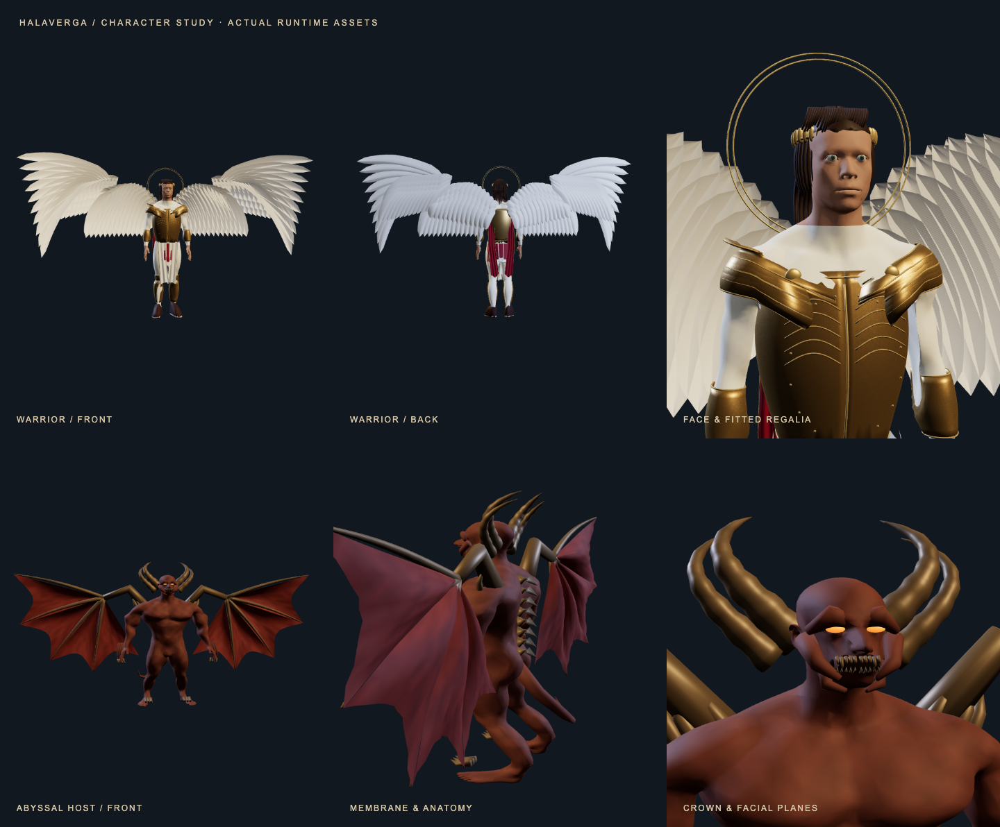
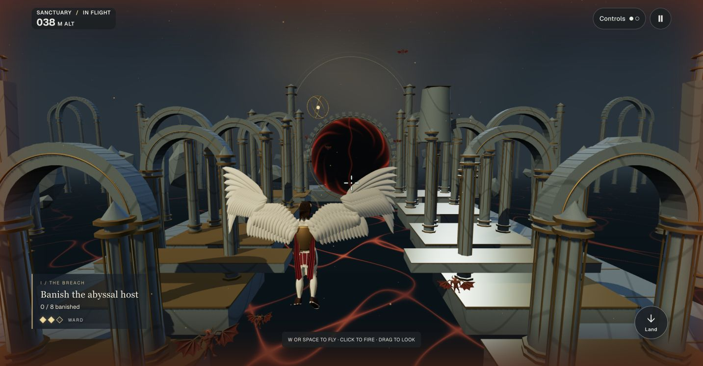
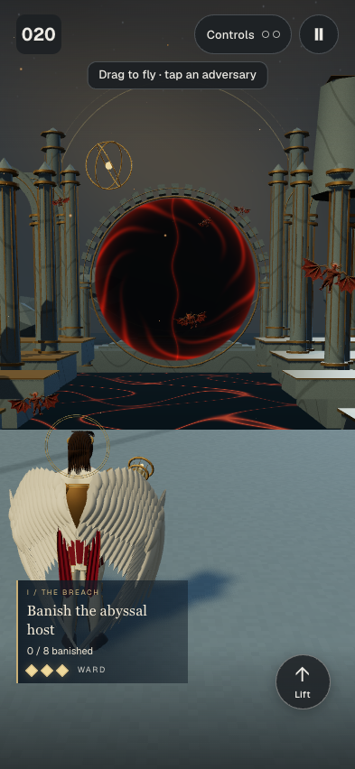
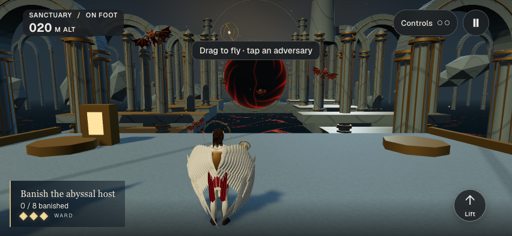

# Character revision — 2026-10-19

This is the character-foundation checkpoint. The later [wing refinement](wing-refinement.md)
supersedes its wing geometry, animation and resource measurements.

Garo rejected the first sanctuary slice's characters as incomplete and basic. This pass
replaces the actual runtime character assets. The screenshots below are rendered from
those assets in Chrome; no generated concept image substitutes for game geometry.

## What changed

The warrior's gold sphere helmet and shoulder shells are removed. Its face and hands
use the approved anatomical mesh with warm skin tones, separate irises, swept layered
hair and an open laurel circlet. A continuous, shaped cuirass bridges the sternum;
shoulder lames, vambraces and greaves are sampled from the body surface, with rolled
edges. Layered pteruges, pleated split linen, a crimson mantle, gilt piping and chased
metal detail replace the two flat tabard panels. Cloth hangs from its waist or chest
fastener instead of inheriting a nearby knee's weights. Three shared original surface
maps add woven fibre and hammered metal detail.

The four animated wing batches contain 198 individually cambered feathers, 28,512
triangles total. Primaries, secondaries and three covert rows overlap in depth, each
feather carrying asymmetric vanes, a raised rachis and a shared fine barb normal map.
The original joint-based flap/fold response to flight, climbing and banking remains.

Adversaries now have anatomical torsos, limbs, hands and facial planes, swept ridged
horns, a recessed toothed mouth, claws, dorsal scutes, a curved tail and membranes
stretched over curved finger struts. Eight instances share pooled geometry and
materials. Wing strokes, small limb flex and breathing use the paused encounter clock;
reduced motion holds these movements still. Their eyes and charge cue sit on the
actual face, and the weak-point centre follows the same rotation as the body. Facing
is tracked separately so shooting down at the back of a head cannot award a weak hit.

## Fidelity and limits

The source boundaries in the [direction](../../plans/2026-10-19-war-in-heaven.md) still
apply: the costumes, two-wing warrior, laurel/nimbus and horned adversary anatomy are
artistic game inventions. Holy wheels remain friendly and untargetable. Source labels
and scripture quotations are unchanged by this character pass.

This is a substantial replacement of blockout assets, with visible remaining art work:
the hero's face needs expression and more natural hair; adversaries need a full
skeletal attack/stagger library; cloth needs collision-aware animation. The existing
flight choreography and procedural motion do not constitute a finished AAA character
animation pipeline. Physical iPhone Safari performance is still unverified.

Build instructions, provenance and exported counts are in
[`art/celestial-characters/README.md`](../../../../art/celestial-characters/README.md).

## Verification

- Type checking and the production build pass. Landing first load is **628.7 KB**
  against the unchanged **629 KB** budget, nine scripts. The vote build check passes.
- **191 unit files / 2,386 tests pass**, including movement/camera grids. New checks
  load the actual GLBs, validate normalized skin weights and their triangle/size
  budgets, exercise casting on the new warrior and align the target with the modeled
  eyes across yaw/pitch/bank. The generic shot solver retains a synthetic protruding-eye
  fixture to exercise rim-only hits independently of this character's proportions.
- **21 browser cases pass** against the production build: flight, casting, source
  distinctions, ward defeat/regroup, automated accessibility, portrait/landscape,
  context-loss recovery and both new model downloads failing once before Reload scene.
- The final material shader correction removes a reversed GLSL `smoothstep` and keeps
  breathing below the head so the modeled face and eye cue remain aligned. Material
  unit checks and the production build pass after that correction; the focused flight,
  download recovery and resource browser checks also pass against the final build
  (**6/6** cases after the shader correction).
- [Resource samples](character-resources.json), high → low → high → low → high:
  **38 calls, 359,602 triangles, 37 geometries, 10 textures**, identical across samples.
  This uses fewer calls/geometries than the first pass (48 / 45), but substantially
  more triangles (127,401 before) and four additional textures. This is the explicit
  detail cost, not evidence of better frame times or an exhaustive leak audit.
- Chrome 155.0.8059.80 on Apple **M2 Max**, macOS **27.0.1**, ANGLE Metal. Viewports
  **393 × 852** and **852 × 393** are emulation. Physical iPhone Safari, VoiceOver,
  sustained thermal behaviour and device frame-time budgets remain unvalidated.

