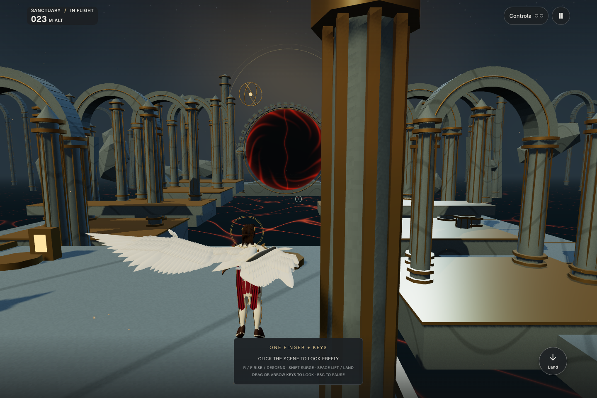

# Obstacle-aware wing folding — 2026-10-19

The player's angel now folds each wing independently near stone, then restores its
flight-selected pose after clearing it. This follows the anatomical wing revision.



[Recorded departure and reopening](wing-clearance.mp4)

## Behaviour

- Passing a column folds the near wing without requiring the far wing to fold.
- A narrow opening can fold both wings. Feathers sweep back along the body in flight.
- The query reserves the whole active hover/climb stroke, including recovery, so a
  raised wing does not wait to hit an arch or beam before responding.
- A settled glide and reduced-motion pose reserve their actual surface, without an
  invisible flapping envelope. Reduced motion retains essential obstacle avoidance.
- Velocity sweeps anticipate up to 0.30 seconds ahead, with 0.16 metres of clearance.
  Closing responds quickly; reopening waits 0.24 seconds, then eases over roughly a
  second. The delay prevents rapid folding/unfolding at a stone edge.
- Pause freezes the pose and clearance timers. A sudden turn or checkpoint can bypass
  the closing ease when necessary to keep the current surface outside stone.

## How clearance is checked

The probes use Rapier's actual fixed colliders: sanctuary stone shares the visible
triangle mesh. Thin solid frames count; the player, sensors and invisible district
limits do not. The wing frame is read after the final body pose and flight-lean
compensation, so the checks follow the displayed bank and orientation.

Three conservative volumes per side cover the humerus, forearm and hand regions.
Every triangle contributes all its vertices and skin weights to bone-local bounds.
Transforming their corners bounds the skin without deforming the full rendered mesh
again for every query. Candidate folds are checked against current stone and swept
along velocity. The flight fold uses the existing shoulder, elbow, wrist and feather
sockets; it changes neither the player collider nor the camera.

The solver chooses among eight clearance intervals, with continuous easing between
them. Its current-pose check can close further after an abrupt turn. It cannot make
an arbitrarily large folded wing fit a space smaller than that wing: this is local
flight clearance, not cloth collision or a new body traversal controller. Closed
grounded wings retain their established pose; enemy membrane wings retain their
separate rig. Character-to-character contact is outside these fixed-stone queries.

## Verification

Unit checks cover every skinned vertex inside the bounds under folded, hovering and
rotated poses; one-sided walls; a narrow passage at 34 m/s; a thin overhead beam;
an abrupt turn; pause; reduced motion; static gliding; collider filtering; and equal
reopening timing at 30/60/120 Hz. Collision cases query all rendered feather
triangles against the test solids, beyond the simplified bounds used at runtime.

The full unit run passed 194 files / 2,405 tests. The final glide/reduced-motion
regression and wing motion checks were then repeated (16 passing checks). Production
build and type checks pass; first load is 628.9 KB within the existing 629 KB budget.
All 23 browser cases passed across the complete run and focused reruns, covering
accessibility, portrait/landscape, flight, the battle, model/GPU recovery and the new
column departure. The final production build repeated seven flight/reload/resource
cases, then passed the column case after correcting its pause-screen assertion
(telemetry is unmounted while paused; the exact frozen pose is unit-tested).

[Five quality-switch samples](wing-clearance-resources.json) remain at 36 draw calls,
353,682 triangles, 35 geometries and 13 textures, matching the previous wing revision.
This demonstrates unchanged settled resource counts; sustained device frame time is
not established by these functional recordings.

The gameplay recording uses the actual sanctuary column, a valid saved landing on
the starting dais, ordinary takeoff and keyboard movement. It verifies asymmetric
tucking, a frozen pause, and restoration after departing the column. It does not
inject a pose or teleport the player during flight.

Chrome desktop and emulated portrait/landscape checks do not establish physical
iPhone Safari performance or VoiceOver validation. No new meshes, textures, physics
colliders or dependencies are added by the clearance solver.

The Research Vault trust audit passed. Reviewed guidance from
`domains/04-product-3d-web/guidance/CURRENT_GUIDANCE.md` informs frame ownership,
transient state and resource handling; its scope does not establish this collision
solver's correctness. That evidence comes from the installed Rapier API, the actual
wing geometry and the regression cases above.

```sh
pnpm exec vitest run tests/wing-clearance.test.ts tests/wing-motion.test.ts --maxWorkers=2
PLAYTEST_URL=http://127.0.0.1:3394 pnpm exec playwright test tests/wing-flight.spec.ts
```
