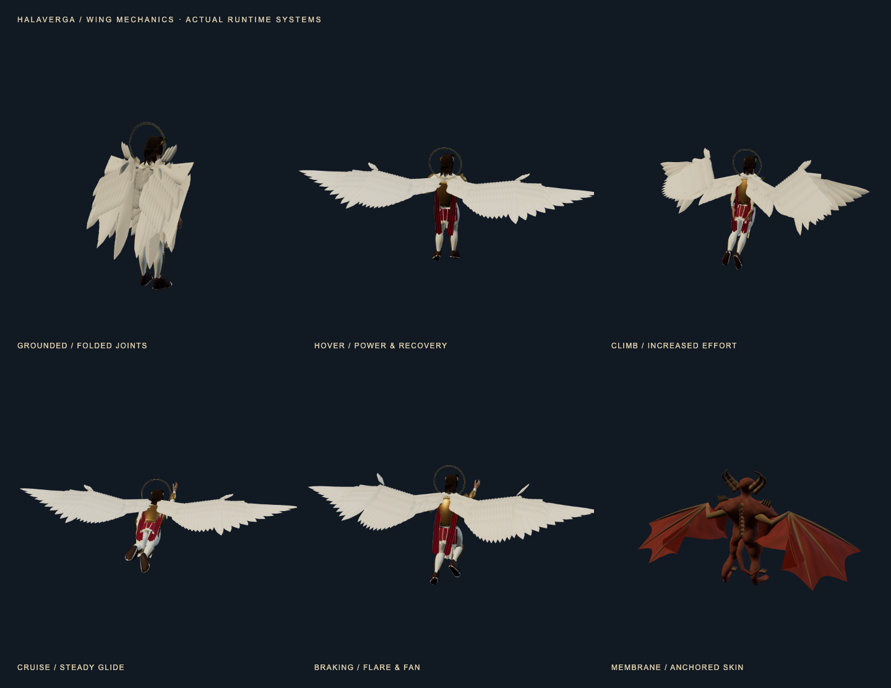

# Wing structure and flight behaviour — 2026-10-19

This revision follows Garo's request for realism and wings that make sense in the
current action. The character revision remains the foundation; this pass changes
wing structure, attachment, feather layout and motion. The body/camera/flight
controller remain authoritative.

The subsequent [obstacle-aware folding pass](wing-clearance.md) now handles flight
clearance near stone and supersedes the obstacle-tucking limitation below.



[Motion study](wing-motion.mp4) · [Recorded gameplay](wing-gameplay.mp4)

## What the wing does

| Situation | Visible response |
|---|---|
| Grounded | Shoulder, elbow and wrist fold; long feathers sweep into a layered stack above the feet. |
| Takeoff | Fast unfolding begins at the raised stroke, followed by stronger initial power strokes. |
| Hover | Broad downstroke; elbow/wrist retract and primary vanes feather during recovery. |
| Fast level flight | Beat amplitude settles toward zero and the extended wing holds a glide. |
| Climbing | Power strokes resume and effort increases even at high forward speed. |
| Braking | More incidence, a wider primary fan and a deployed alula make the flare readable. |
| Banking | The flight frame retains the body's actual bank; small asymmetric wing adjustments accompany it. |
| Paused | The complete pose, stroke clock and unfolding state stop. |
| Reduced motion | Repetitive strokes and feather flutter stop; action-selected poses remain. |

The old angel wing was a vertical fan that pitched with the torso. The new wing has
humeral, forearm and hand regions, a cambered feather bed and a coherent planform.
Outer primaries attach in the correct distal-to-proximal order. Secondaries overlap
along the forearm; smaller coverts conceal the calami above and below. Feather sockets
permit the long vanes and coverts to sweep into the fold rather than sticking out as
one rigid panel. Each side renders as one skinned mesh, with 106 bones and 181 feathers.
Together the wings use **23,104 triangles**, within the existing 30,000-triangle cap.

The wing frame reads the final character transform after posing and casting. It
counters the avatar's forward flight lean while retaining the actual bank and flight
pitch, so the lifting surface stays oriented to flight as the torso tips prone. This
is a visual transform on the wing attachment; it never writes the player or camera.

The adversary wing now has a shoulder/elbow/wrist skeleton, elongated digit supports,
interdigital skin, leading-edge skin and a true inner attachment to the flank. Its
geometry is authored in a flight plane. The previous whole-wing rotation around the
body centre is removed. Both shoulders remain fixed during the stroke, the elbow and
wrist flex during recovery, and normalized blended weights keep the skin continuous.
Eight creatures share a **4 KB** float matrix palette, delivered as one texture; this
avoids large vertex-uniform arrays. Their body hit spheres and face weak points stay
in their existing gameplay coordinates.

## Reference boundaries

The [Cornell Lab feather guide](https://academy.allaboutbirds.org/feathers-article/)
informs asymmetric vanes, overlapping secondaries, feather attachments and covert
coverage. [Pigeon joint measurements](https://pmc.ncbi.nlm.nih.gov/articles/PMC5582118/)
inform coupled elbow/wrist folding; [pigeon turning research](https://pmc.ncbi.nlm.nih.gov/articles/PMC3250151/)
supports treating power and recovery as distinct phases. [Bat kinematic measurements](https://journals.biologists.com/jeb/article/213/12/2142/9935/Kinematics-of-flight-and-the-relationship-to-the)
inform separate shoulder, wrist and digit-supported membrane movement.

These are structural references, not a reproduction of one bird or bat species. Stroke
frequency, human-scale proportions, extra back-mounted limbs and assisted flight are
authored fantasy choices. This does not assert that a humanoid in armour could fly
biologically. Scripture labels, source distinctions and friendly holy wheels are
unchanged. No reference image or third-party model is bundled.

## Verification and limits

The focused tests cover frozen pause state, reduced motion, timing at 30/60/120 Hz,
hover-to-glide/climb/brake transitions, folded ground clearance, root attachment,
recovery span, torso-lean compensation, retained bank, normalized skin weights and
constant membrane bone lengths. The motion study renders the actual runtime builders
and authored flight clips in Chrome, rather than an offline beauty render.

The full unit suite passes **193 files / 2,397 tests**; wing-focused checks are repeated
after the final feather-fold refinement. Production build and first-load checks pass:
**628.7 KB / 629 KB**, nine scripts. Browser results and final resource samples are
recorded against the production build. All **22 browser cases** pass: 21 existing
flight, battle, viewport, accessibility and recovery checks, plus the new recorded
takeoff/hover/fast-flight/braking case. The new case uses the real keyboard control
profile and Surge, verifies speed above 20 m/s, then verifies braking below 0.6 m/s.
After its input correction, the seven flight, model-reload and resource checks were
rerun together and passed.

The [five high/low resource samples](wing-resources.json) settle at **36 draw calls,
353,682 triangles, 35 geometries and 13 textures** each. The foundation used 38 calls,
359,602 triangles, 37 geometries and 10 textures: fewer wing batches and triangles,
with two skeleton textures and the membrane matrix palette added. These are resource
counts, not a measured frame-rate improvement. The captures use Chrome on an M2 Max;
the six-view motion study is a separate inspection scene. The gameplay recording is
the actual production game, including its normal controls and interface.

Wings are visual flight choreography. The flight controller generates movement; the
wingbeat does not simulate aerodynamic forces. World collision still uses the body
capsule, so wings can intersect nearby stone. Obstacle-aware tucking/contact, broader
cloth collision and richer character expression remain further refinement passes.
Physical iPhone Safari, VoiceOver and sustained device frame times remain unvalidated.

## Reproduction

The inspection script requires Chrome and `ffmpeg` on the PATH. Playwright retains
the raw gameplay recording in its report; the committed review clips use H.264 MP4.

```sh
/Applications/Blender.app/Contents/MacOS/Blender --background --factory-startup --python scripts/celestial_characters/build.py
node scripts/review-wing-motion.mjs
pnpm exec vitest run tests/wing-motion.test.ts tests/membrane-rig.test.ts --maxWorkers=2
```

The matrix palette, skeleton textures, feather geometry and generated surface maps
are explicitly owned and disposed. The reviewed Research Vault guidance was retrieved
with a passing trust audit from `domains/04-product-3d-web/guidance/CURRENT_GUIDANCE.md`;
its scope covers the web renderer and resource lifecycle, not biological rigging.
