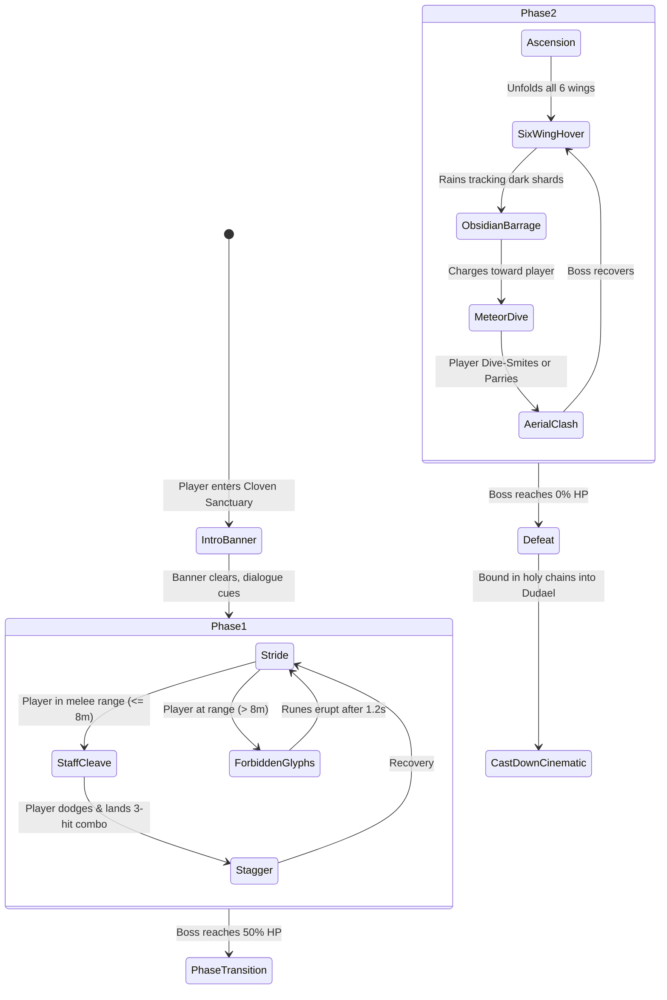

# Hades on Mount Hermon: Celestial Boss Showdown with Semjaza

**Approved Setting**: Mount Hermon at dawn in the days of Jared (*1 Enoch 6*).
**Revision**: 2.0 (Post-EGM Review Resolution)
**Status**: Ready for Implementation (All 6 EGM Blockers Resolved)

---

## 1. Executive Summary & Core Objectives

Transform Halaverga from the legacy procedural drone-shooter into a true *Hades*-inspired, third-person mythic showdown on the heights of Mount Hermon: **Archangel of the Covenant vs. Semjaza, Chief of the Two Hundred**.

### Core Pillars
1. **Eradicate FPS Gun/Drone Tropes**: No crosshair reticle, bullet spread, or target-practice drone rings.
2. **Celestial Spear & Melee Combat**: Spear of Dawn with light-arc combos, charged throws with recall, i-frame seraphic dash, and aerial dive smites.
3. **Legendary Boss: Semjaza**: Multi-phase showdown against the towering Chief of the Watchers (Phase 1: Ground stride, dark glyphs, staff cleaves; Phase 2: Six-winged aerial flight, obsidian barrage, meteor clash).
4. **Hades Narrative Staging**: Intro title card (*"SEMJAZA — Chief of the Two Hundred"*), classical gold-obsidian boss health bar, scripture-based dialogue cards, and ancient acoustic harmonics.

---

## 2. Resolution of EGM Material Blockers

### Blocker 1: Unified Control Mapping (Flight & Combat Integration)

Combat seamlessly integrates into Halaverga's flight engine without overwriting assisted flight:

| Platform / Profile | Navigation / Flight | Attack / Spear Combo | Spear Throw / Recall | Seraphic Dash (i-frames) | Dive Smite |
| :--- | :--- | :--- | :--- | :--- | :--- |
| **Desktop (Trackpad)** | Move pointer to steer; 2-finger scroll for speed | `Click` on ground / hover (or `C`) | `Hold Right-Click` to charge; release to throw; click to recall | `Shift` or double-tap direction | In flight: `Space` or dive downward |
| **Desktop (Keys / WASD)** | `W/A/S/D` to move; mouse to steer | `Left Click` or `C` | `Right Click` (throw/recall) | `Shift` (Dash) | `F` (descend/smite) while descending |
| **Mobile (One-Thumb Classic)** | Hold & drag open area to steer | `Tap Semjaza` to strike | `Hold on Semjaza` to throw; tap to recall | Quick flick / double-tap | Tap `Land` while descending at speed |
| **Mobile (Twin-Stick)** | Left stick moves; right drags view | `Fire` button (now "Strike") | `Hold Strike` to aim/throw | `Dash` button (replaces Aim) | `Descend` button while airborne |

> [!NOTE]
> When airborne at cruising speed, attacking triggers an aerial dash-strike that flows with flight momentum rather than halting the player.

---

### Blocker 2: Code-Splitting & First-Load JS Budget (<= 629.0 KB)

To protect the 628.3 KB landing bundle:
1. `BossHud.tsx` and `DialogueBox.tsx` are **strictly dynamic chunks** (`next/dynamic` with `ssr: false`).
2. They are warmed ONLY after `Begin` / `Ascend` is clicked when entering the Hermon summit arena.
3. Zero boss or combat UI modules are statically imported in `Landing.tsx` or `layout.tsx`.
4. Tests verify that `Landing first load` remains <= 629.0 KB via `scripts/check-first-load.mjs`.

---

### Blocker 3: Player Health, Wards, and Respawn Lifecycle

1. **Covenant Wards (Player Health)**:
   - The player possesses **3 Covenant Wards** (represented as radiant solar pips in the HUD).
   - Taking a direct hit from Semjaza's staff cleave or dark lightning rune shatters 1 Ward and triggers 1.5s of invulnerability flashing.
2. **Seraphic Dash i-Frames**:
   - Dashing grants 0.35s of complete invulnerability, allowing skilled players to dash straight through dark glyph eruptions and sweeping staff strikes.
3. **Defeat & Recovery Loop**:
   - Losing all 3 Wards triggers a celestial dissipation animation.
   - The player respawns smoothly at the Threshold of Hermon summit altar (`0, 20, 65`) with restored Wards, allowing an immediate re-attempt.

---

### Blocker 4: Arena Containment, Tethering, and Leashing

1. **The Covenant Sanctuary Perimeter**:
   - The boss arena is bounded by the Cloven Summit Colosseum (radius **110 metres** centered on `x: 30, z: -38`).
   - Ancient megalithic covenant ward steles define the outer boundary with a subtle shimmering dawn aura.
2. **Boss Tethering**:
   - Semjaza remains strictly within the 110m arena. If the player retreats past 120m, Semjaza taunts from the sanctuary altar; his dark lightning cannot reach past the boundary.
   - Spear throws past 100m automatically recall with a golden harmonic hum.

---

### Blocker 5: Strict Module Decomposition (< 200 Lines)

All components are partitioned into focused, single-responsibility files strictly under 200 lines:

| Module Path | Responsibility | Line Budget |
| :--- | :--- | :--- |
| `src/game/semjazaBoss.ts` | Boss state machine (Phases 1 & 2, health, transitions) | ~140 lines |
| `src/game/semjazaAttacks.ts` | Attack timing, ground rune math, cleave hitboxes | ~130 lines |
| `src/world/semjazaMesh.ts` | Obsidian armor, head, torso, dark lightning staff geometry | ~150 lines |
| `src/world/semjazaWings.ts` | Six-wing articulation and feather geometry | ~130 lines |
| `src/world/Semjaza.tsx` | R3F boss component, animation loop tick, boundary checks | ~140 lines |
| `src/game/spearCombat.ts` | Player attack state, combos, dash i-frames, damage calc | ~140 lines |
| `src/game/spearThrow.ts` | Spear ballistics, embedding, recall arc math | ~120 lines |
| `src/world/spearMesh.ts` | Luminous Spear of Dawn geometry and trailing ribbon | ~110 lines |
| `src/ui/BossHud.tsx` | Top boss health bar, intro nameplate banner, ward pips | ~150 lines |
| `src/ui/DialogueBox.tsx` | Narrative dialogue cards with 1 Enoch scripture text | ~120 lines |

---

### Blocker 6: Single Authoritative Camera Writer

- `CameraRig.tsx` remains the **sole authoritative camera writer** at priority -10.
- Boss framing and intro sequences communicate with `CameraRig.tsx` strictly via state flags in `runtime.combat` (e.g. `runtime.bossFocus: Vector3` and `runtime.bossLetterbox: boolean`).
- `CameraRig.tsx` smoothly blends the target focus without any external component mutating `camera.position` or `camera.rotation` directly.

---

## 3. Boss Choreography: Semjaza, Chief of the Two Hundred

---

## 4. Verification & Quality Gates

1. **Unit Tests**:
   - `tests/semjaza-boss.test.ts`: State machine transitions, phase 1 -> 2 trigger, health reduction.
   - `tests/semjaza-attacks.test.ts`: Rune placement math, cleave radius checks.
   - `tests/spear-combat.test.ts`: 3-hit combo windows, dash i-frame duration, spear throw and recall.
2. **Bundle Verification**:
   - `node scripts/check-first-load.mjs`: Landing first-load JS <= 629.0 KB.
   - `node scripts/check-vote-build.mjs`: Route handlers and static pages intact.
3. **Module Size**:
   - `wc -l` on all 10 new files in `src/` confirms strictly < 200 lines.
4. **Browser & Visual Review**:
   - Chrome ANGLE Metal capture of boss intro banner, spear attacks, and Phase 2 flight clash.
